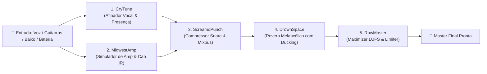

# 🖤 ROADMAP: EMO AUDIO TOOLS — UNDERGROUND TOOLS

> **Armas de estúdio e produção musical para a cena independente.**  
> *100% Código Aberto • Sem Paywall • Sem iLok / Dongles • Sem Assinatura • Sem Firula Corporativa.*

---

## 🏴 1. Manifesto & Filosofia

O mercado de plugins de produção musical tornou-se refém de softwares inflados, instaladores invasivos com serviços em segundo plano, plataformas antipirataria (iLok) que travam o computador e assinaturas mensais abusivas.

A **Emo Audio Tools** nasce como parte do ecossistema [**Underground Tools**](https://github.com/FelipeGardenghiDev/underground-tools) para entregar uma **suíte essencial de 5 ferramentas de mixagem e gravação**, gratuitas, de código aberto e ultra-diretas ao ponto, com identidade visual inspirada na cultura zine dos anos 90/2000 e calibrada com timbres icônicos da cena **Emo, Screamo, Midwest Emo, Pop-Punk e Post-Hardcore**.

---

## 🎛️ 2. A Suíte dos 5 Plugins Essenciais



---

### 🎸 Plugin 1: **MidwestAmp** *(Guitar & Bass Tube Amp Sim + Cabinet IR)*
* **Objetivo:** O timbre de guitarra definitivo para a cena alternativa sem precisar de amplificadores de R$ 15.000.
* **Canais / Modos de Timbre:**
  1. **Kinsella Clean (Midwest Emo):** Som limpo, percussivo, brilhante e estalado para afinações abertas (*FACGCE, DAEAC#E*) e dedilhados matemáticos (American Football, TTNG, Algernon Cadwallader).
  2. **Drive & Grit (Emo / Indie 90s):** Timbre valvulado empurrado no limiar do rompimento (*edge-of-breakup*), dinâmico ao toque da palheta (Sunny Day Real Estate, Mineral, Jimmy Eat World).
  3. **Black Parade Wall (2000s Post-Hardcore / Screamo):** Paredão massivo de distorção de alto ganho estilo Marshall JCM800 + Mesa Boogie Dual Rectifier com agudos cortantes e graves firmes (My Chemical Romance, The Used, Silverstein, Underoath).
* **Controles:**
  - `Gain` (Ganho de entrada / saturação de válvulas)
  - `Bass / Middle / Treble` (Tone Stack interativo passivo de 3 bandas)
  - `Presence` (Brilho das harmônicas superiores)
  - `Cab Select` (Seleção de impulso IR embutido: 2x12 Open Back, 4x12 Vintage 30, Bass 8x10)
  - `Master Volume` (Nível de saída com limitador de segurança)

---

### 🎙️ Plugin 2: **CryTune** *(Pitch Corrector & Vocal Presence)*
* **Objetivo:** Afinação vocal intuitiva que vai da correção transparente e intimista até o hard-tune expressivo dos anos 2000.
* **Motor DSP:** Detecção no domínio do tempo via algoritmo YIN / McLeod Pitch Method acoplado a fatiamento de fase PSOLA (*Pitch-Synchronous Overlap-Add*).
* **Controles:**
  - `Key & Scale` (Escala da música: ex: C Major, D Minor, Pentatônica)
  - `Speed / Tightness` (Velocidade de transição: de 50ms para natural até 0ms para robô dramático)
  - `Air / Screamo Presence` (Filtro passa-altas de presença a 8 kHz para fazer o vocal sussurrado ou berrado cortar as guitarras dobradas)

---

### 💥 Plugin 3: **ScreamoPunch** *(Snare Crack & Vocal Grab Compressor)*
* **Objetivo:** O compressor agressivo que faz a caixa da bateria dar aquele tiro seco na cara e amarra vocais caóticos sem complicar com tempos milimétricos de attack/release.
* **Controles:**
  - `Punch` (Macro de ataque rápido e recuperação musical com saturação sutil)
  - `Smash` (Quantidade de compressão / redução de ganho com medidor estilo agulha retroiluminada)
  - `Mix` (Controle Dry/Wet para compressão paralela no estilo Nova York)

---

### 🌊 Plugin 4: **DrownSpace** *(Melancholic Ambient Reverb & Tape Flutter)*
* **Objetivo:** Reverb profundo e melancólico com recurso exclusivo de **Ducking Automático** (o reverb se afasta discretamente quando a voz ou solo toca, e preenche o espaço nos silêncios).
* **Controles:**
  - `Decay` (Tamanho do espaço: de garagem úmida a catedral gótica abandonada)
  - `Drown / Ducking` (Nível de compressão sidechain interna automática na cauda do reverb)
  - `Cassette Flutter` (Modulação nostálgica de *wow/flutter* simulando fita K7 gasta)

---

### 📼 Plugin 5: **RawMaster** *(Brickwall Limiter & Loudness Maximizer)*
* **Objetivo:** Deixar a mixagem final no volume comercial do Spotify e Bandcamp sem esmagar os transientes da bateria e sem gerar distorção digital.
* **Controles:**
  - `Target LUFS` (Preset seletor: `-14 LUFS` para Streaming ou `-9 LUFS` para som de CD quente)
  - `Ceiling` (Teto travado a `-0.3 dB True Peak` para evitar clip na conversão MP3)
  - `LUFS Live Meter` (Medidor integrado verde/amarelo/vermelho em tempo real)

---

## 🏗️ 3. Arquitetura de Código & Monorepo

Os plugins residem diretamente dentro do repositório [`underground-tools`](https://github.com/FelipeGardenghiDev/underground-tools):

```
underground-tools/
├── apps/
│   └── web/                   # Next.js 16 + Tailwind CSS v4
│       └── src/app/plugins/   # 🚀 Vitrine zine com downloads e áudios Antes/Depois
├── plugins/                   # 🎛️ Código-fonte dos plugins nativos
│   ├── midwest-amp/           # Plugin de Guitarra/Baixo
│   │   ├── src/               # Código DSP C++ / Header-only
│   │   ├── irs/               # Impulse Responses embutidas (.wav)
│   │   ├── CMakeLists.txt     # Script de compilação universal
│   │   └── README.md
│   ├── cry-tune/
│   ├── screamo-punch/
│   ├── drown-space/
│   └── raw-master/
├── .github/
│   └── workflows/
│       └── build-plugins.yml  # 🤖 Compilação multiplataforma no GitHub Actions
├── docs/
│   └── ROADMAP_EMO_AUDIO_TOOLS.md
```

---

## 🤖 4. Pipeline de Compilação Multiplataforma (GitHub Actions)

Toda vez que uma nova versão for publicada no repositório, o GitHub Actions executa uma matriz automatizada:
1. **Windows Runner (`windows-latest`):** Compila o `.vst3` e `.clap` de 64 bits utilizando MSVC / CMake.
2. **macOS Runner (`macos-latest`):** Compila o binário universal para Mac (suporte nativo para processadores Intel e Apple Silicon M1/M2/M3/M4).
3. **Linux Runner (`ubuntu-latest`):** Compila o `.vst3` e `.clap` para distribuições Linux (Ubuntu, Debian, Fedora, Arch).
4. **Publicação Automática:** Empacota os arquivos em um `.zip` assinado e cria uma **Release oficial** com link direto de download no site.

---

## 🎯 5. Próximos Passos de Execução

1. **Passo 1:** Criar a pasta base `plugins/midwest-amp` com a modelagem do motor de pré-amplificador, equalizador tone stack passivo e convolutor de gabinete.
2. **Passo 2:** Fornecer os impulsos de áudio de gabinetes clássicos embutidos (*Midwest 2x12 Clean, British 4x12 Greenback, American 4x12 V30*).
3. **Passo 3:** Criar a página de apresentação e download em `apps/web/src/app/plugins/page.tsx` no visual zine do Underground Tools.
